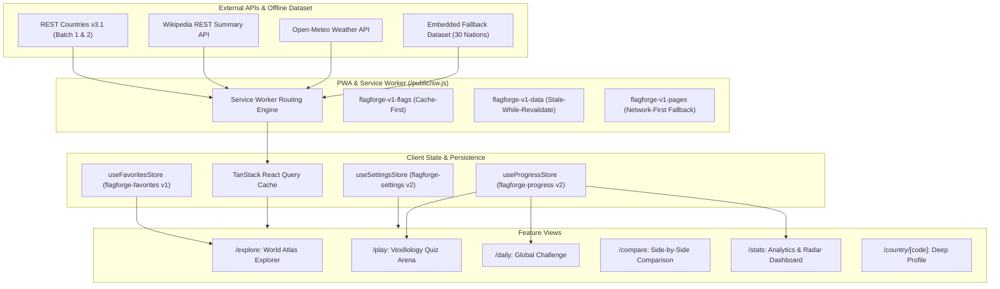

# FlagForge — Interactive World Atlas & Vexillology Arena

[](https://nextjs.org/)
[](https://react.dev/)
[](https://www.typescriptlang.org/)
[](https://tailwindcss.com/)
[](https://www.w3.org/WAI/standards-guidelines/wcag/)
[](https://web.dev/progressive-web-apps/)

**FlagForge** is a fast, offline-first interactive world atlas, vexillology quiz arena, and nation demographic comparison platform. Master world geography, national flags, capitals, and geopolitical statistics through real-time quizzes, daily global challenges, and side-by-side data visualizations.

---

## Architecture & System Overview

FlagForge uses a unidirectional, typed architecture leveraging Next.js 15 App Router, React 19 Server & Client Components, TanStack Query, and Zustand stores with versioned LocalStorage persistence.



---

## Feature Matrix

| Feature | Description | Key Capabilities |
|---|---|---|
| **World Atlas Explorer** | Filter and search all 250+ sovereign nations and territories | Instant fuzzy search (`fuse.js`), region & subregion filters, population range slider, landlocked / UN filters, grid / list view, favorite bookmarks. |
| **Quiz Arena** | Interactive vexillology and geography games | 4 quiz modes (`flag_to_country`, `country_to_flag`, `capital_to_country`, `border_challenge`), 3 difficulty tiers, speed bonuses, score streaks, live countdown timer, lives mode. |
| **Daily Global Challenge** | Standardized daily geography challenge | Deterministic PRNG seed based on UTC date, 10 standardized flag questions, shareable emoji results grid, streak preservation. |
| **Side-by-Side Compare** | Multi-country demographic comparison matrix | Up to 3 countries compared across population, surface area, borders, languages, currencies; interactive Recharts bar charts and demographic radar index. |
| **Stats Dashboard** | In-depth performance insights & analytics | Historical activity heatmap, region proficiency radar charts, weakest flags review, achievement badges. |
| **Deep Country Profiles** | Comprehensive national profiles (`/country/[code]`) | Pre-rendered static pages for major nations, live capital weather from Open-Meteo, Wikipedia summary extracts, interactive border links. |

---

## Keyboard Navigation & Shortcuts

FlagForge is engineered for rapid keyboard-first navigation and satisfies WCAG 2.2 AA accessibility standards.

| Key Shortcut | Context | Action |
|---|---|---|
| <kbd>1</kbd>, <kbd>2</kbd>, <kbd>3</kbd>, <kbd>4</kbd> | Active Quiz / Daily Challenge | Select corresponding answer option (A, B, C, D) |
| <kbd>Space</kbd> or <kbd>Enter</kbd> | Quiz Answer Review | Advance to the next question |
| <kbd>Esc</kbd> | Active Quiz | Pause or unpause the game session |
| <kbd>Ctrl</kbd> + <kbd>K</kbd> / <kbd>⌘</kbd> + <kbd>K</kbd> | Global | Open the instant Command Palette search |
| <kbd>Tab</kbd> / <kbd>Shift + Tab</kbd> | Global | Accessible focus traversal with visible focus rings |
| Skip to Main Content | Global Header | Immediate keyboard bypass of navigation directly to `#main-content` |

---

## Offline Capabilities & PWA Architecture

FlagForge is a Progressive Web App (PWA) that functions offline:

1. **Installable App**: Includes a web manifest (`/src/app/manifest.ts`) supporting desktop and mobile installation.
2. **Vanilla Service Worker (`/public/sw.js`)**:
   - **Flags & Assets (`Cache-First`)**: FlagCDN and Wikimedia images are cached locally on first load (`flagforge-v1-flags`).
   - **REST Countries Data (`Stale-While-Revalidate`)**: API calls return instant cached responses while refreshing in the background.
   - **Navigation Routes (`Network-First with Cache Fallback`)**: Visited routes are cached in `flagforge-v1-pages`. If offline, cached views or `/offline.html` are displayed.
3. **Embedded Fallback Dataset**: If network connectivity is lost before any API response is received, the app falls back to an embedded 30-country offline dataset (`src/lib/api/fallback-countries.ts`).

---

## API Layer Reference

The typed API layer is housed under `/src/lib/api`:

- **REST Countries Client (`restcountries.ts`)**:
  - Implements compliant batched requests (max 10 fields per query per REST Countries API guidelines).
  - Parallel fetches Batch 1 (identity, demographics) and Batch 2 (geography, borders) with in-memory caching and Zod schema validation.
  - Automatic retry with exponential backoff and timeout handling.
- **Wikipedia Client (`wikipedia.ts`)**:
  - Fetches contextual summary extracts, thumbnails, and canonical encyclopedia links.
- **Weather Client (`weather.ts`)**:
  - Fetches capital city weather from Open-Meteo using latitude/longitude coordinates.
  - Normalizes WMO weather codes into human-readable condition labels, temperature in Celsius, and wind speed.

---

## Getting Started & Development

### Prerequisites

- **Node.js**: `v20.x` or `v22.x`
- **pnpm**: `v9.x` or `v10.x` (`corepack enable && corepack prepare pnpm@latest --activate`)

### Installation

```bash
# Clone the repository
git clone https://github.com/your-org/flagforge.git
cd flagforge

# Install dependencies
pnpm install --frozen-lockfile
```

### Running Locally

```bash
# Start Next.js development server
pnpm run dev
```

Visit [http://localhost:3000](http://localhost:3000) to view FlagForge.

---

## Verification & Testing Scripts

```bash
# 1. Typecheck TypeScript codebase
pnpm run typecheck

# 2. Run ESLint code quality checks
pnpm run lint

# 3. Execute Vitest unit & component test suite
pnpm run test

# 4. Execute Vitest test suite with coverage
pnpm run test:coverage

# 5. Execute Playwright E2E and WCAG 2.2 AA accessibility audit
pnpm run e2e

# 6. Production build verification
pnpm run build
```

---

## Production Deployment

### Deploy to Vercel

```bash
# Deploy with Vercel CLI
vercel --prod
```

Configure `NEXT_PUBLIC_APP_URL` in your environment variables.

### Deploy with Docker

```bash
# Build and run Docker container
docker compose up -d --build
```

The application will be running at [http://localhost:3000](http://localhost:3000).

For in-depth deployment documentation, see [Production Deployment Guide](docs/deploy.md).  
For the complete test and accessibility audit report, see [QA Report](docs/qa-report.md).
