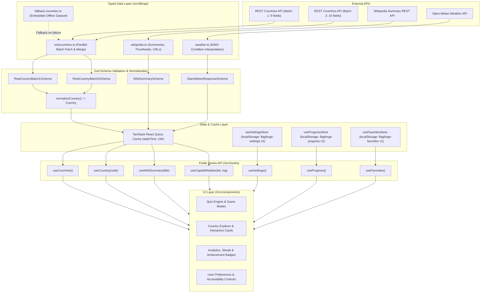

# FlagForge Architecture & Technical Contract

This document provides the foundational engineering architecture, data contracts, store schemas, public hooks API reference, and inter-agent handoff guidelines for **FlagForge**.

---

## 1. System Architecture Overview

FlagForge is a high-performance, mobile-first geography explorer and quiz progressive web application. The core system architecture follows a unidirectional data flow with strict schema validation at API boundaries, persistent offline-capable client state, and unified custom React hooks.



---

## 2. REST Countries Field Restriction & Batch Normalization

### 2.1 The Strict <= 10 Fields Rule
The REST Countries v3.1 API enforces strict performance limits when querying `/all` or `/alpha`. Calling the API without the `?fields=` parameter transfers over 5MB of uncompressed JSON, causing high latency, CPU parse overhead on mobile devices, and rate limits.

**Strict Mandate:** Every request to `restcountries.com` MUST include a `?fields=` parameter with **at most 10 comma-separated fields**.

### 2.2 Parallel Batch Merging Strategy
To construct the complete normalized `Country` entity without violating the field restriction, requests are split into two parallel requests joined on `cca3`:

| Batch | Query Parameter | Field Count | Fields Included |
| :--- | :--- | :---: | :--- |
| **Batch 1** | `?fields=cca3,name,capital,region,subregion,flags,population,area,cca2` | 9 | `cca3`, `name`, `capital`, `region`, `subregion`, `flags`, `population`, `area`, `cca2` |
| **Batch 2** | `?fields=cca3,languages,currencies,borders,latlng,timezones,continents,landlocked,unMember,car` | 10 | `cca3`, `languages`, `currencies`, `borders`, `latlng`, `timezones`, `continents`, `landlocked`, `unMember`, `car` |

Both batches execute concurrently using `Promise.all()`. Responses are indexed by `cca3.toUpperCase()` and merged through `normalizeCountry(batch1, batch2)`:

```ts
const [rawBatch1, rawBatch2] = await Promise.all([
  fetchWithRetryAndTimeout(urlBatch1, { signal }),
  fetchWithRetryAndTimeout(urlBatch2, { signal }),
]);
```

### 2.3 Offline Resilience & Embedded Fallback
If network failure, device disconnection, or REST Countries downtime occurs, `getAllCountries()` automatically falls back to `FALLBACK_COUNTRIES` located in `/src/lib/api/fallback-countries.ts`. The UI continues running seamlessly without crashes or blank states.

---

## 3. External API Integrations

### 3.1 Wikipedia Summary REST API
- **Endpoint:** `https://en.wikipedia.org/api/rest_v1/page/summary/${encodeURIComponent(title)}`
- **Extracted Fields:** `title`, `extract`, `description`, `thumbnail` (`source`, `width`, `height`), `content_urls.desktop.page`.
- **Resilience:** 6-second timeout, 2 exponential backoff retries, in-memory caching.
- **Error Handling:** Non-existent articles return `AppError` with `isNotFound: true` without crashing.

### 3.2 Open-Meteo Weather API
- **Endpoint:** `https://api.open-meteo.com/v1/forecast?latitude=${lat}&longitude=${lng}&current=temperature_2m,relative_humidity_2m,apparent_temperature,precipitation,weather_code,wind_speed_10m,is_day`
- **Output:** Normalized `WeatherData` containing:
  - `temperature` (°C)
  - `apparentTemp` (°C)
  - `humidity` (%)
  - `windSpeed` (km/h)
  - `precipitation` (mm)
  - `condition` (human-readable string e.g. "Mainly clear", "Drizzle", "Thunderstorm")
  - `iconKey` (`clear-day` | `clear-night` | `cloudy` | `fog` | `rain` | `snow` | `thunderstorm`)
  - `isDay` (boolean)
- **Caching:** 15-minute TTL per coordinate pair.

---

## 4. Domain Models & Type System

All types reside in `/src/types` and are exported through `/src/types/index.ts`.

### 4.1 Normalized Country Entity
```ts
export interface Country {
  cca3: string;
  cca2: string;
  name: {
    common: string;
    official: string;
    nativeName?: Record<string, { official: string; common: string }>;
  };
  capital: string[];
  region: string;
  subregion: string;
  languages: Record<string, string>;
  currencies: Record<string, { name: string; symbol: string }>;
  borders: string[];
  population: number;
  area: number;
  flags: {
    png: string;
    svg: string;
    alt?: string;
  };
  latlng: [number, number];
  capitalInfo?: { latlng?: [number, number] };
  timezones: string[];
  continents: string[];
  landlocked: boolean;
  unMember: boolean;
  callingCodes: string[];
  carSide?: "right" | "left";
}
```

### 4.2 Typed Application Errors
```ts
export type ErrorCode =
  | "NETWORK_ERROR"
  | "TIMEOUT_ERROR"
  | "NOT_FOUND"
  | "PARSE_ERROR"
  | "RATE_LIMITED"
  | "SERVER_ERROR"
  | "OFFLINE_FALLBACK"
  | "UNKNOWN_ERROR";

export class AppError extends Error {
  readonly code: ErrorCode;
  readonly status?: number;
  readonly isNetwork: boolean;
  readonly isNotFound: boolean;
  readonly retryable: boolean;
  readonly cause?: unknown;
}
```

---

## 5. Zustand State Management & Migrations

All stores feature `zustand/persist` in `localStorage` with versioned schema migrations.

### 5.1 Settings Store (`flagforge-settings`, Version 2)
- **Path:** `/src/store/useSettingsStore.ts`
- **State:**
  - `theme`: `"system" | "light" | "dark"`
  - `sound`: `boolean` (default `false`)
  - `reducedMotion`: `boolean` (default `false`)
  - `units`: `"metric" | "imperial"` (default `"metric"`)
  - `highContrast`: `boolean` (default `false`)
- **Version 1 -> Version 2 Migration:** Guarantees `units`, `highContrast`, and `reducedMotion` properties exist if upgrading from legacy schemas.

### 5.2 Progress & Analytics Store (`flagforge-progress`, Version 2)
- **Path:** `/src/store/useProgressStore.ts`
- **State:**
  - `streak`: `{ current: number, best: number, lastActiveDate: string | null }`
  - `totalGamesPlayed`: `number`
  - `totalQuestionsAnswered`: `number`
  - `totalCorrectAnswers`: `number`
  - `regionAccuracy`: `Record<string, { total: number, correct: number }>`
  - `modeAccuracy`: `Record<string, { total: number, correct: number }>`
  - `questionHistory`: `Array<{ id, date, countryCode, mode, correct }>` (strictly capped to the last 200 answers)
  - `dailyChallenges`: `Record<string, { date, score, total, answers, completedAt }>`
  - `achievements`: `AchievementItem[]`
- **Streak Calculation:** Evaluates ISO calendar dates. Consecutive days increment `current` and update `best`. Missing a day resets `current` to 1. Same-day actions preserve streak.
- **Achievement Engine:** Triggered automatically upon answering questions, finishing games, and completing daily challenges.

### 5.3 Favorites Store (`flagforge-favorites`, Version 1)
- **Path:** `/src/store/useFavoritesStore.ts`
- **State:**
  - `favorites`: `string[]` (uppercase `cca3` codes)
  - `recentSearches`: `string[]` (strictly capped to 10 unique recent queries)

---

## 6. Public Hooks API Reference

All application features should consume data and state through `/src/hooks`.

### `useCountries()`
Fetches all countries with TanStack Query caching and offline status.
```tsx
import { useCountries } from "@/hooks";

export function CountryList() {
  const { countries, isLoading, isError, error, isOffline, refetch } = useCountries();

  if (isLoading) return <div>Loading countries...</div>;
  if (isError) return <div>Error loading data: {error?.message}</div>;

  return (
    <div>
      {isOffline && <div className="banner">Working offline (cached dataset)</div>}
      <p>Loaded {countries.length} countries.</p>
    </div>
  );
}
```

### `useCountry(code?: string)`
Fetches a single country by alpha-2 or alpha-3 code, resolving its bordering countries.
```tsx
import { useCountry } from "@/hooks";

export function CountryDetail({ code }: { code: string }) {
  const { country, borders, isLoading, isError } = useCountry(code);

  if (isLoading) return <div>Loading country...</div>;
  if (!country) return <div>Country not found</div>;

  return (
    <div>
      <h1>{country.name.common}</h1>
      <h3>Borders:</h3>
      <ul>
        {borders.map((b) => (
          <li key={b.cca3}>{b.name.common}</li>
        ))}
      </ul>
    </div>
  );
}
```

### `useWikiSummary(countryName?: string)`
Fetches Wikipedia summary and thumbnail.
```tsx
import { useWikiSummary } from "@/hooks";

export function WikiCard({ name }: { name: string }) {
  const { summary, isLoading, isError } = useWikiSummary(name);

  if (isLoading) return <div>Fetching encyclopedic summary...</div>;
  if (isError || !summary) return null;

  return (
    <article>
      <h4>{summary.title}</h4>
      <p>{summary.extract}</p>
    </article>
  );
}
```

### `useCapitalWeather(lat?: number, lng?: number)`
Fetches real-time capital weather from Open-Meteo.
```tsx
import { useCapitalWeather } from "@/hooks";

export function WeatherBadge({ lat, lng }: { lat?: number; lng?: number }) {
  const { weather, isLoading } = useCapitalWeather(lat, lng);

  if (isLoading || !weather) return null;

  return (
    <div>
      <span>{weather.temperature}°C</span>
      <span>{weather.condition}</span>
    </div>
  );
}
```

### `useProgress()`
Convenience selector for user quiz stats and recording game answers.
```tsx
import { useProgress } from "@/hooks";

export function ScoreSummary() {
  const { streak, overallAccuracy, totalGamesPlayed, recordAnswer } = useProgress();

  return (
    <div>
      <div>Current Streak: {streak.current} days 🔥</div>
      <div>Accuracy: {overallAccuracy}%</div>
      <div>Games Played: {totalGamesPlayed}</div>
    </div>
  );
}
```

### `useSettings()`
Controls user preferences (dark mode, sound, units).
```tsx
import { useSettings } from "@/hooks";

export function SettingsToggle() {
  const { theme, sound, setTheme, toggleSound } = useSettings();

  return (
    <div>
      <button onClick={() => setTheme(theme === "dark" ? "light" : "dark")}>
        Toggle Theme ({theme})
      </button>
      <button onClick={toggleSound}>Sound: {sound ? "On" : "Off"}</button>
    </div>
  );
}
```

### `useFavorites()`
Manages bookmarked countries.
```tsx
import { useFavorites } from "@/hooks";

export function FavoriteButton({ cca3 }: { cca3: string }) {
  const { isFavorite, toggleFavorite } = useFavorites();
  const active = isFavorite(cca3);

  return (
    <button onClick={() => toggleFavorite(cca3)}>
      {active ? "★ Favorited" : "☆ Add to Favorites"}
    </button>
  );
}
```

---

## 7. Guidelines & Ownership Boundaries for Other Agents

1. **Ownership Boundaries:**
   - **Agent 1 Owns:** `/src/lib`, `/src/types`, `/src/store`, `/src/hooks`, `/src/tests`, `/docs/architecture.md`.
   - **UI Engineers (Agent 2, Agent 3) Own:** `/src/components/*`, `/src/app/*`.
2. **Access Data via Hooks:**
   - Never import direct `fetch` calls into UI components. Always use the public hooks in `@/hooks`.
3. **Handle Empty / Offline / Error States:**
   - Check `isLoading`, `isError`, and `isOffline` from hooks.
   - Use `AppError.isNotFound` to present 404 cards instead of generic errors.
4. **Strict TypeScript & Classnames:**
   - Use `cn()` from `@/lib/utils` for conditional Tailwind class merging.
   - Never use `any`. Use domain types exported from `@/types`.
